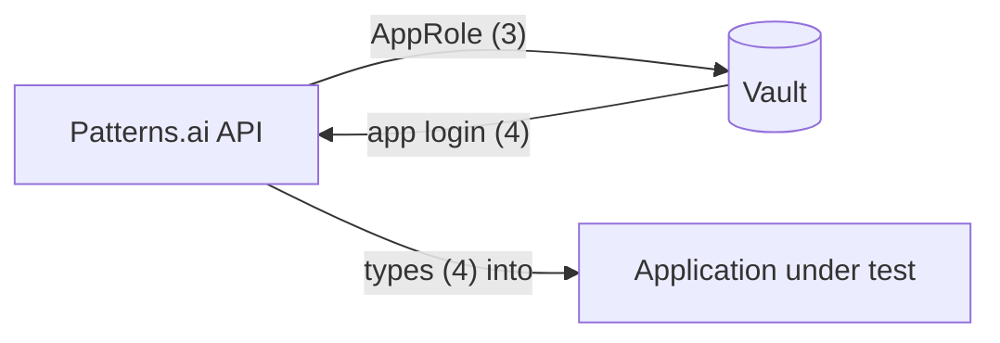

# Patterns.ai — Autonomous AI Test Intelligence Platform

An enterprise, AI-first platform that behaves like an autonomous QA engineer:
upload product documentation, point it at your application, and let AI agents
explore the app, generate scenarios, and run self-healing tests via Playwright —
without manual locator maintenance.

> **Status:** Foundation + AI vertical + Playwright/MCP exploration & execution
> engine are all implemented and run end-to-end: multi-tenant auth (Auth0),
> project/environment management, Requirement ("Business Context") ingestion,
> AI scenario generation, goal-driven app exploration via Playwright MCP,
> record → replay → self-heal test execution, test suites, reporting, audit
> log, and notifications.

---

## Architecture

Clean Architecture with CQRS (MediatR). Dependencies point inward only.

```
src/
  ATIP.Domain          # Entities, enums, domain rules (no dependencies)
  ATIP.Application     # CQRS commands/queries, DTOs, validators, interfaces
  ATIP.Infrastructure  # EF Core (PostgreSQL), Playwright/MCP engine, AI client,
                       #   identity, security, persistence, notifications
  ATIP.Api             # ASP.NET Core Web API, controllers, SignalR hubs, Swagger
tests/
  ATIP.Application.Tests
frontend/              # React 19 + TypeScript + Vite + Tailwind (shadcn/ui) +
                       #   TanStack Query + Zustand + React Router
tools/
  mcp/                  # Local Playwright MCP server used by the exploration engine
  vault/                # Local HashiCorp Vault dev server + setup script
  e2e/                  # Python harness to bulk-run/seed scenarios for regression
  testrail/             # Scripts to seed/sync TestRail test cases
```

Key backend building blocks:

- **Multi-tenancy** — every tenant-scoped entity is filtered by a global EF Core
  query filter; tenants cannot see each other's data. Tenants are provisioned
  automatically (JIT) on first Auth0 login, grouped by email domain.
- **Soft delete** — a `SaveChanges` interceptor converts deletes to soft deletes
  and stamps audit columns automatically.
- **Auth** — Auth0 (OIDC/JWT bearer). The API validates tokens against your Auth0
  tenant; `ApiKeyAuthenticationHandler` also accepts an `X-Api-Key` header for
  CI/scripted access. RBAC via `SystemRole` + project-scoped `ProjectRole`.
- **Secrets** — connection strings and secret environment variables are encrypted at rest with
  AES-256-GCM and a rotatable key id, and are write-only through the API. Application
  credentials can also live in **HashiCorp Vault** and are fetched only at run time. Secret
  values are masked before anything reaches the AI, the live log or stored results — see
  [Secrets & application credentials](#secrets--application-credentials).
- **Validation** — FluentValidation runs in a MediatR pipeline behavior and maps
  to RFC 7807 problem details.
- **AI exploration engine** — `ExplorerAgent` drives a headless Chromium browser
  through the Playwright MCP protocol, asks an LLM to decide the next action,
  records the concrete steps it performed, and streams live progress (log/steps/
  screenshots) to the frontend over SignalR.

## Tech stack

| Layer      | Technology |
|------------|------------|
| Backend    | .NET 10, ASP.NET Core, MediatR, FluentValidation, EF Core, Serilog, SignalR |
| Database   | PostgreSQL |
| Auth       | Auth0 (OIDC / JWT), API keys for CI |
| Frontend   | React 19, TypeScript, Vite, Tailwind CSS (shadcn/ui), TanStack Query, Zustand, React Router |
| AI         | Any OpenAI-compatible endpoint (OpenAI, Azure OpenAI, LiteLLM, local LM Studio/Ollama) or Anthropic (Claude) |
| Automation | Microsoft.Playwright (.NET) + Playwright MCP (Node, `@playwright/mcp`) |
| Secrets    | AES-256-GCM at rest, HashiCorp Vault (KV v2, AppRole) |

---

## Prerequisites

- **.NET SDK 10.x** — https://dotnet.microsoft.com/download
- **Node.js 20+** and npm
- **PostgreSQL 14+** — either a local install or via the bundled `docker-compose.yml`
- **Python 3** — only needed for the optional scripts under `tools/e2e` and `tools/flipkart`
- An **Auth0** tenant (free tier is fine) — or reuse the baked-in dev defaults described below to get running immediately without creating your own tenant
- (Optional) an API key for a real LLM provider — the platform requires one configured for
  AI features (requirement analysis, scenario generation, exploration); there is no offline mock
- (Optional) **HashiCorp Vault** — to keep the tested application's credentials in Vault
  (`brew tap hashicorp/tap && brew install hashicorp/tap/vault`, or the `vault` service in
  `docker-compose.yml`)

## Getting started

### 1. Start PostgreSQL and apply migrations

The easiest path is the setup script, which starts Postgres, waits for it to be
ready, and applies all EF Core migrations in one step:

```bash
tools/db/setup-db.sh            # Docker Postgres (docker-compose.yml), port 5433
tools/db/setup-db.sh --local    # use an existing local PostgreSQL install, port 5432
tools/db/setup-db.sh --reset    # drop and rebuild the database first
```

Or do it manually:

**Option A — Docker (recommended for a clean environment):**

```bash
docker compose up -d
# Postgres is exposed on host port 5433 to avoid clashing with a local install.
# Update ConnectionStrings:Postgres (appsettings.Development.json) to Port=5433 if you use this.
```

**Option B — existing local PostgreSQL** (the default connection string uses port 5432):

```bash
psql postgres -c "CREATE ROLE atip LOGIN PASSWORD 'atip';"
psql postgres -c "CREATE DATABASE atip OWNER atip;"
```

Either way, EF Core migrations are also applied automatically the first time you
run the API (step 4), so the script is a convenience, not a requirement.

### 2. Install Playwright browsers (backend automation engine)

The backend drives a real Chromium browser both directly (`Microsoft.Playwright`)
and via the local MCP server in `tools/mcp/`. Install the browser once:

```bash
# .NET Playwright's bundled browser (used by the direct replay/execution engine)
dotnet build src/ATIP.Infrastructure
node ~/.nuget/packages/microsoft.playwright/1.52.0/.playwright/package/cli.js install chromium

# Node MCP server used by the exploration agent
cd tools/mcp && npm install && cd ../..
```

### 3. Configure the backend

`src/ATIP.Api/appsettings.Development.json` (git-ignored-in-spirit; treat it as
local secrets) holds environment-specific config. At minimum you need:

```jsonc
{
  "Llm": {
    "Provider": "openai",              // "openai" | "azure" | "anthropic"
    "Endpoint": "https://api.openai.com/v1/chat/completions",
    "ApiKey": "sk-...",
    "Model": "gpt-4o-mini"
  },
  "PlaywrightMcp": {
    "Enabled": true,
    "Command": "/absolute/path/to/QANexus/tools/mcp/playwright-mcp.sh",
    "Arguments": [ "--headless", "--isolated", "--browser", "chromium" ]
  }
}
```

> **Windows:** `playwright-mcp.sh` needs a POSIX shell to execute, and the
> backend launches `Command` as a raw process (no shell), so Windows can't
> run the `.sh` wrapper directly. Point `Command`/`Arguments` at Node and the
> CLI script instead:
> ```jsonc
> "Command": "node",
> "Arguments": [ "/absolute/path/to/QANexus/tools/mcp/node_modules/@playwright/mcp/cli.js", "--headless", "--isolated", "--browser", "chromium" ]
> ```

See [AI provider configuration](#ai-provider-configuration) below for other
providers (Azure OpenAI, Anthropic/Claude, local LM Studio/Ollama, Gemini).
`Auth0` (Domain/Audience/ClientId) already has working dev-tenant defaults in
`appsettings.json`, so you can skip Auth0 setup entirely for local use — see
step 5.

### 4. Run the backend

```bash
dotnet run --project src/ATIP.Api
```

- API: http://localhost:5125 (Swagger UI at `/swagger`)
- EF Core migrations are applied automatically on startup in Development.
- Health/liveness check: `GET /api/v1/projects` (should return `401` unauthenticated, not `500`).

> ⚠️ Never pass `--no-launch-profile` — it skips `launchSettings.json` and binds
> to ASP.NET's default port (5000) instead of 5125, which the frontend's Vite
> proxy is hardcoded to target.

### 5. Run the frontend

```bash
cd frontend
npm install     # also downloads a Playwright Chromium build (postinstall)
npm run dev
```

- App: http://localhost:5173 (Vite proxies `/api`, `/hubs`, `/health` to `http://localhost:5125`).
- The bundled dev Auth0 tenant defaults (`frontend/src/lib/auth0.ts`) let you log in out of
  the box. To use your own Auth0 tenant instead, copy `frontend/.env.example` to `.env` and
  fill in `VITE_AUTH0_DOMAIN` / `VITE_AUTH0_CLIENT_ID` / `VITE_AUTH0_AUDIENCE` — see the
  comments in that file for the exact Auth0 application settings required (callback/logout
  URLs, API identifier, a Login Action to add email/name claims). The values must match the
  backend's `Auth0` section in `appsettings.json`.

### 6. Try it

1. Open http://localhost:5173 and log in (Auth0 redirect) — a tenant + admin user are
   provisioned automatically on first login (JIT), grouped by your email domain.
2. Create a project; add an environment with your application's base URL.
3. Upload a document under **Business Context**, or write a user story, to generate scenarios.
4. Open a scenario and click **Explore** to watch the AI agent ground real steps against your
   app, then **Accept** the discovered steps and **Run** the scenario as a repeatable test.

---

## Secrets & application credentials

Four different sets of credentials are involved. They are never the same:

| # | Credential | Used by | Lives in |
|---|---|---|---|
| 1 | Your Patterns.ai login | You, to use Patterns.ai | Auth0 |
| 2 | Vault admin login (dev: root token `dev-root`) | You, to manage secrets | Vault |
| 3 | Vault AppRole `RoleId` + `SecretId` | The Patterns.ai API, to read from Vault | .NET user-secrets / env vars |
| 4 | **The tested app's username/password** | The explorer, typed into your app | Stored as data **inside** Vault (or as an encrypted *Secret* variable) |



### Environment variable types

Environment → **Variables** binds `{{key}}` tokens used in scenario steps:

| Type | Stored | Notes |
|---|---|---|
| Text | Plain | Shown and editable. |
| Secret | AES-256-GCM encrypted in the database | Write-only: never returned by the API; leave blank to keep, clear with ✕. |
| Vault | A reference `path#field` | Value is read from Vault when a run starts. Use the ✓ button to test the reference. |

Secret and Vault values (and test-data columns named like `password`, `token`, `apiKey`, `otp`)
are treated as secrets: the AI only ever sees `{{password}}` / `[secret:password]`, the real value
is substituted at the moment it is typed into the browser, and logs, live view, step results and
saved DOM snapshots are masked. Recorded steps keep the placeholder, so rotating a password in Vault
needs no test changes.

### Local Vault setup

```bash
brew tap hashicorp/tap && brew install hashicorp/tap/vault   # or: docker compose up -d vault

tools/vault/dev-server.sh      # terminal 1 — in-memory dev Vault on 127.0.0.1:8200, root token dev-root
tools/vault/setup-dev.sh       # terminal 2 — then restart the API
```

`setup-dev.sh` is idempotent. It enables KV v2 at `secret/`, creates a read-only policy
`patternsai-read` (`secret/data/patternsai/*`), creates the AppRole `patternsai`, stores the API's `Vault:*`
settings in .NET user-secrets (outside the repo), and seeds a demo secret per tenant at
`secret/patternsai/<tenantId>/demo/saucedemo`.

> Dev mode keeps everything in memory. After restarting Vault, rerun `setup-dev.sh` and restart the API.

Vault UI: http://127.0.0.1:8200/ui → method **Token** → `dev-root`.

### Using application credentials in a test

1. Store the login under your tenant's folder (each tenant can only read `patternsai/<its tenantId>/…`):
   ```bash
   export VAULT_ADDR=http://127.0.0.1:8200 VAULT_TOKEN=dev-root
   vault kv put secret/patternsai/<tenantId>/saucedemo/standard username=standard_user password=secret_sauce
   ```
2. In Patterns.ai, add environment variables of type **Vault**:
   `username` → `saucedemo/standard#username`, `password` → `saucedemo/standard#password`.
3. Write steps with the tokens, e.g. *Enter `{{username}}` into Username and `{{password}}` into
   Password, then click Login.*

### Vault configuration

```jsonc
"Vault": {
  "Enabled": true,
  "Address": "https://vault.example.com:8200",
  "Namespace": "",                      // Vault Enterprise / HCP only
  "MountPath": "secret",                 // KV v2 mount
  "PathPrefix": "patternsai/{tenantId}", // per-tenant isolation; references are relative to this
  "AuthMethod": "approle",               // or "token"
  "RoleId": "…", "SecretId": "…",        // never commit — use env vars / user-secrets
  "CacheSeconds": 60
}
```

In production run Vault in server mode (TLS, auto-unseal) and pass credentials as environment
variables, e.g. `Vault__RoleId` / `Vault__SecretId`.

---

## AI provider configuration

The exploration/generation features require a real LLM — there is no offline mock. Configure
`Llm` in `appsettings.Development.json` (or via `Llm__*` environment variables, e.g. for a
one-off run):

```bash
# OpenAI
Llm__Provider=openai Llm__Endpoint=https://api.openai.com/v1/chat/completions \
  Llm__Model=gpt-4o-mini Llm__ApiKey=<key> dotnet run --project src/ATIP.Api

# Azure OpenAI
Llm__Provider=azure Llm__Endpoint=https://<resource>.openai.azure.com/openai/deployments/<deployment>/chat/completions?api-version=2025-04-01-preview \
  Llm__ApiKey=<key> Llm__Model=<deployment> dotnet run --project src/ATIP.Api

# Anthropic / Claude
Llm__Provider=anthropic Llm__Model=claude-sonnet-4-5-20250929 Llm__ApiKey=<key> \
  dotnet run --project src/ATIP.Api

# Local (LM Studio / Ollama / vLLM — no key required)
Llm__Provider=openai Llm__Endpoint=http://localhost:1234/v1/chat/completions \
  Llm__Model=<loaded-model-name> dotnet run --project src/ATIP.Api

# Google Gemini (via its OpenAI-compatible endpoint)
Llm__Provider=openai Llm__Endpoint=https://generativelanguage.googleapis.com/v1beta/openai/chat/completions \
  Llm__ApiKey=<gemini-key> Llm__Model=gemini-1.5-pro dotnet run --project src/ATIP.Api
```

If the LLM call fails or isn't configured, the operation fails with a clear error
(no silent fallback) so you always know whether you're looking at real AI output.

## Optional integrations

- **TestRail sync** — set the `TestRail` section (`BaseUrl`/`Username`/`ApiKey`) to enable
  "Sync from TestRail" on the Scenarios tab. Seed scripts: `tools/testrail/seed-*.mjs`.
- **Jira** — set the `Jira` section to enable fetching a Jira issue's summary/description
  when authoring a scenario.

---

## API overview

All endpoints are versioned under `/api/v1`. Authenticate with `Authorization: Bearer <auth0-token>`
(obtained by the frontend after Auth0 login) or an `X-Api-Key` header (for CI/scripts — see
Administration → API Keys in the UI).

| Method | Route | Description |
|--------|-------|-------------|
| GET/POST | `/projects` | List / create projects |
| GET/PUT/DELETE | `/projects/{id}` | Get / update / soft-delete a project |
| GET/POST/DELETE | `/projects/{id}/environments` | Manage environments |
| GET/PUT | `/projects/{id}/environments/{envId}/variables` | Environment variables (`{{key}}`; types text / secret / vault) |
| GET/POST/DELETE | `/projects/{id}/environments/{envId}/test-data` | Environment-scoped test data sets |
| GET/POST | `/projects/{id}/requirements` | List / upload (multipart) Business Context docs |
| GET/POST | `/projects/{id}/scenarios` | List / create scenarios (manual, generated, imported) |
| POST | `/projects/{id}/scenarios/generate-from-story` | AI-generate scenarios from a user story |
| POST | `/projects/{id}/scenarios/sync/testrail` | Import cases from TestRail |
| POST | `/projects/{id}/scenarios/{id}/explore` | Goal-driven AI exploration (discovers real steps) |
| POST | `/projects/{id}/scenarios/{id}/run` | Deterministic replay of the scenario's saved steps |
| POST | `/projects/{id}/scenarios/{id}/proposed-steps/apply` \| `/discard` | Accept / discard AI-discovered steps |
| GET/POST/PUT/DELETE | `/projects/{id}/suites` | Test suites (grouped scenarios) |
| POST | `/projects/{id}/suites/{id}/run` | Run a suite (optionally filtered by tag/type/priority) |
| GET | `/projects/{id}/explorer/sessions/{id}` | Poll an exploration/run session's status & steps |
| GET | `/dashboard/summary`, `/reports/summary` | Aggregate KPIs |
| GET/POST | `/api-keys` | Manage CI API keys |
| GET | `/secret-store/status` | Vault connectivity / authentication status |
| POST | `/secret-store/verify` | Check a `path#field` reference resolves (never returns the value) |
| GET | `/audit` | Tenant audit log |

Live progress (browser frames, log lines, per-step results) streams over SignalR at `/hubs/exploration`.
Swagger (`/swagger`) has the full, current contract.

## Database migrations

```bash
# Requires: dotnet tool install --global dotnet-ef --version 10.0.10 (must match the EF Core
# runtime version exactly — a mismatched dotnet-ef fails with "Method not found").
dotnet ef migrations add <Name> \
  --project src/ATIP.Infrastructure \
  --startup-project src/ATIP.Api \
  --output-dir Persistence/Migrations
```

Migrations apply automatically on API startup in Development — no manual `database update` needed.

## Tests

```bash
dotnet test
```

## Useful scripts (`tools/`)

- `tools/db/setup-db.sh` — provisions Postgres (Docker or local) and applies EF Core migrations
  in one step; see step 1 of Getting started.
- `tools/mcp/` — the local Playwright MCP server the exploration engine spawns as a subprocess.
  `playwright-mcp.sh` is the wrapper script referenced by `PlaywrightMcp:Command` in appsettings.
- `tools/vault/dev-server.sh` / `setup-dev.sh` — local HashiCorp Vault for development; see
  [Local Vault setup](#local-vault-setup).
- `tools/e2e/run-all.py <projectId> <envId>` — bulk explore + replay every scenario in a project,
  useful as a regression sanity check.
- `tools/testrail/seed-*.mjs` — create/replace TestRail test cases for the demo apps under `demo/`.

---

## Troubleshooting

- **Frontend shows `500` on every `/api` call** — the backend isn't listening on port 5125 (Vite's
  proxy target is hardcoded to it). Make sure you started it with plain
  `dotnet run --project src/ATIP.Api` (no `--no-launch-profile`) and check
  `lsof -iTCP -sTCP:LISTEN -n -P | grep 5125`.
- **`dotnet ef` fails with "Method not found"** — your global `dotnet-ef` tool version doesn't match
  the EF Core NuGet version. Reinstall: `dotnet tool update --global dotnet-ef --version 10.0.10`.
- **`dotnet`/`dotnet-ef` not found in a new terminal** — if the SDK was installed to `~/.dotnet`,
  ensure `~/.zshrc` (or equivalent) exports `DOTNET_ROOT="$HOME/.dotnet"` and adds
  `$HOME/.dotnet:$HOME/.dotnet/tools` to `PATH`.
- **Exploration/generation errors out immediately** — no LLM is configured, or the configured
  provider rejected the request; check the `Llm` section (see
  [AI provider configuration](#ai-provider-configuration)) and the API console log for the
  provider's own error message.
- **Local Postgres already running on 5432** — either point `ConnectionStrings:Postgres` at the
  docker-compose instance (port 5433) instead, or stop the local instance.
- **"Vault variable not resolved" in the run log / Vault warning in the Variables dialog** — check
  `GET /api/v1/secret-store/status`. *Unreachable*: start `tools/vault/dev-server.sh`.
  *AppRole login failed*: dev Vault was restarted — rerun `tools/vault/setup-dev.sh` and restart the
  API. *Not found*: the secret must live under `secret/patternsai/<tenantId>/` and the reference is
  relative to that folder.

## Roadmap

- Login profiles: named accounts (`runAs: admin`) backed by Vault, with automatic login, MFA (TOTP)
  and reusable browser sessions
- Knowledge Graph visualization (backend + UI exist but are currently unwired from navigation)
- Locator-quarantine dashboards / trend analytics on top of the existing self-healing engine
- CI/CD pipeline templates (Jenkins/GitHub Actions) and Docker/Kubernetes/Helm deployment manifests
- Mobile (Appium) and API/DB test platforms — engine support exists (`TestPlatform` enum,
  `AppiumMobileDriver`, `HttpApiDriver`, `SqlDataDriver`) but is not yet exposed in the authoring UI
